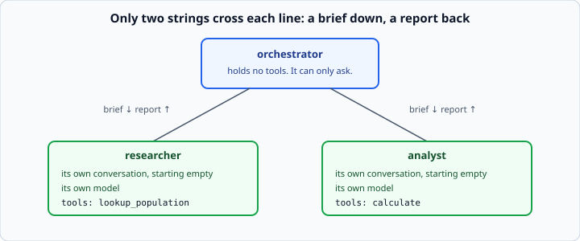

# Orchestrator and workers

*Week 11 · Day 3 · about 25 minutes*

> By the end of this you can build an agent whose tools are other agents, bound what it
> can do, and say what the arrangement costs.

---

## Read the official documentation first

| Page | What it gives you |
|---|---|
| [**Building effective agents**](https://www.anthropic.com/engineering/building-effective-agents) | The *Orchestrator-workers* pattern, and when the simpler patterns are enough |

---

## The pattern



One agent decides what needs doing and who should do it. The others do the pieces. The
orchestrator never touches a real tool, and the workers never talk to each other.

In code it is the loop you already own:

```python
schemas = [worker_schema(worker) for worker in workers]
tools = {f"ask_{worker['name']}": delegate_to(worker) for worker in workers}

result = run_agent(client, ORCHESTRATOR_SYSTEM, schemas, tools, question)
```

`delegate_to(worker)` returns a function that takes a brief, runs the worker, and
returns its report. Everything else — the tool-use turn, the result going back as a
user message, the step cap — is unchanged from week 7.

---

## Why the orchestrator holds nothing

It is tempting to give the orchestrator the calculator as well, "for the easy ones".

Do that and it has two ways to do arithmetic: itself, or by asking. It will choose
inconsistently, the analyst becomes an occasional extra cost, and you can no longer say
what each agent is responsible for. **An orchestrator that can do the work is one agent
with assistants it does not need.**

The clean rule is the useful one: the orchestrator plans and briefs; workers act.

---

## The prompt that matters

A worker's prompt says what it is for. The orchestrator's prompt has a harder job:
getting a model to write a good **brief**, which it does not do by default.

The instruction that changes its behaviour is a plain statement of fact:

```
A worker sees nothing but its brief. Give it the goal, what is already known,
and what to send back.
```

Then read the briefs it produces. Print `delegations` after every run for the first
week you work on a team. It is the multi-agent equivalent of week 7's "print the
list", and for the same reason: the bug is almost always visible in what was sent.

---

## Three limits

A single agent needed a step cap. A team needs more, because it has more ways to run
away.

**1. A cap on the orchestrator's steps.** Unchanged from week 7.

**2. A cap on each worker's steps.** Each worker is a loop of its own.

**3. A cap on delegations.** An orchestrator that is unhappy with a report will ask
again. And again. Each ask is a whole worker run — several model calls. Past the limit
the worker is **not run**, and the orchestrator is told so:

```
Refused: delegation limit of 4 reached.
```

Multiply the three together for the worst case before you ship: eight orchestrator
steps, four delegations of six steps each is thirty-two model calls for one question.
That is the number a budget guard has to be built around.

---

## Failure, three ways

| Inside the worker | What crosses back |
|---|---|
| It answered | its text |
| It hit its step cap | `Worker researcher did not finish: ...` |
| Its model call raised | `Worker researcher failed: overloaded` |

All three are strings. None is an exception by the time it reaches the orchestrator.

This is week 7's *"a failed tool is information"* one level up, and it matters more
here. With three agents, each calling a model several times, the chance that *something*
is briefly unavailable in a run is several times higher than for one agent. A team that
falls over whenever any member has a bad second will fall over a lot.

---

## What it costs

Count the model calls for *"How many people live in Lisbon and Bogota combined?"*:

| | Calls |
|---|---|
| **One agent:** look up, look up, calculate, answer | 4 |
| **Team:** orchestrator 3, researcher 3, analyst 2 | 8 |

Twice the calls. Roughly twice the latency, since they run one after another. Somewhat
less than twice the tokens, because each agent's context is shorter than the single
agent's would have been.

The overhead is structural, not sloppy: the orchestrator spends a call deciding to
delegate and another reading each report, and each worker spends a final call writing
up. You pay those for every delegation whether or not the split helped.

So the question for Friday is never "does the team work". It is: **what did the extra
four calls buy?**

---

## Check yourself

1. Why must a refused delegation still appear in the log?
2. Your orchestrator answers a three-city question with a two-city total. Where do you
   look first?
3. A team has 8 orchestrator steps, a delegation limit of 4 and 6 steps per worker.
   What is the worst case in model calls?

<details>
<summary>Answers</summary>

1. Because the log is how you find out the limit was hit. An orchestrator that kept
   asking is a symptom — a bad brief, or a worker that cannot do the job — and a log
   that hides the refused asks hides the symptom.
2. **The delegations.** Read the brief the researcher got and the report it sent. Either
   the brief named two cities, or the report dropped one. The code is rarely the
   problem.
3. **32.** Eight for the orchestrator, plus four delegations of six.
</details>

---

## What you can now do

- [ ] Build an orchestrator from the loop you already have
- [ ] Say why an orchestrator should hold no tools of its own
- [ ] Write the instruction that gets a model to brief properly, and check the result
- [ ] Bound a team with three limits, and work out its worst case
- [ ] Turn every worker failure into a string the orchestrator can act on
- [ ] Count a team's model calls per agent

**Next:** [Parallel workers and permissions](../day-4/parallel-workers-and-permissions.md)
— the two things a team can do that one agent cannot.
